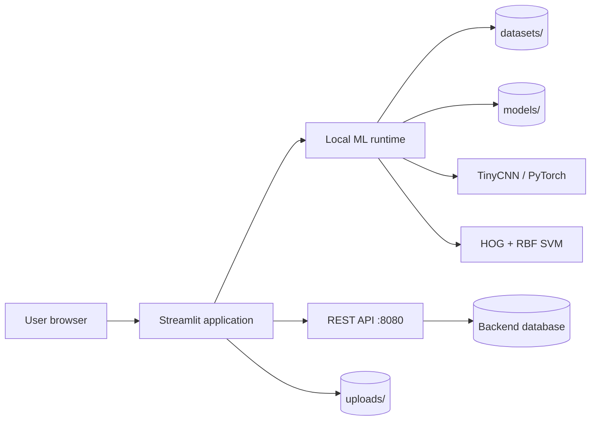
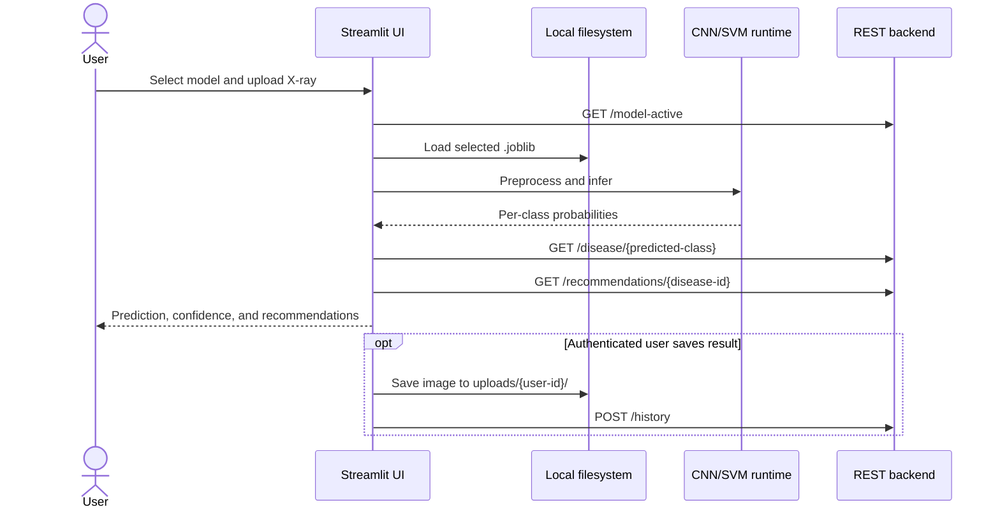

# Lung Disease Prediction System

A Streamlit application for training and using image-classification models on chest X-rays. The application supports two model families—**TinyCNN** and **SVM with HOG features**—and provides account management, prediction history, dataset administration, model management, and health-recommendation management through a separate REST API.

> [!IMPORTANT]
> This project is an educational/research prototype. Its output is **not a medical diagnosis** and must not replace evaluation by a qualified healthcare professional. Before any clinical use, the models, datasets, calibration, security, and workflow require independent medical and regulatory validation.

## Table of contents

- [Overview](#overview)
- [Main features](#main-features)
- [System architecture](#system-architecture)
- [Project structure](#project-structure)
- [Prerequisites](#prerequisites)
- [Installation](#installation)
- [Backend dependency](#backend-dependency)
- [Running the application](#running-the-application)
- [Using the application](#using-the-application)
- [Dataset format](#dataset-format)
- [Machine-learning pipeline](#machine-learning-pipeline)
- [Model artifact format](#model-artifact-format)
- [REST API contract](#rest-api-contract)
- [Technical implementation](#technical-implementation)
- [Known limitations and security notes](#known-limitations-and-security-notes)
- [Troubleshooting](#troubleshooting)

## Overview

The system classifies a chest X-ray into one of the disease classes selected during training. It can then retrieve a description and preventive/treatment recommendations associated with the predicted class. Authenticated users can save and review prediction history, while administrators can upload datasets, train models, activate or delete models, and maintain recommendations.

This repository contains the **Python/Streamlit frontend and local ML training/inference code**. It does **not** contain the backend service or its database. The frontend expects that service to be running at `http://localhost:8080/api/v1`.

## Main features

### User features

- Register and log in through the REST backend.
- Keep a browser session using encrypted cookies.
- Select an active CNN or SVM model registered by an administrator.
- Upload a JPG, JPEG, or PNG chest X-ray.
- View the predicted class, confidence, and per-class probabilities.
- View a disease description and health recommendations returned by the backend.
- Save a prediction and uploaded image to history.
- View and delete the current user's prediction history.

### Administrator features

- Upload one or more images into a local class folder.
- Upload and extract a ZIP dataset.
- Register new datasets and disease metadata with the backend.
- Train a multiclass TinyCNN or RBF-SVM model using selected classes.
- View accuracy, precision, recall, F1-score, and a confusion matrix.
- Persist trained models as Joblib artifacts.
- Register models and their dataset relationships with the backend.
- Activate/deactivate or delete registered models.
- Create, update, list, and delete disease recommendations.

## System architecture



The responsibilities are separated as follows:

| Component | Responsibility |
| --- | --- |
| Streamlit application | Navigation, forms, image preview, training controls, metrics, and prediction display |
| Local ML runtime | Image preprocessing, model training, evaluation, serialization, and inference |
| REST backend | Authentication, users, disease metadata, recommendations, model registry, dataset registry, and history |
| Local filesystem | Dataset images, trained Joblib files, and saved prediction images |

## Project structure

```text
lung_disease_predict/
├── app.py                         # Streamlit entry point and role-based navigation
├── model_cnn.py                   # CNN training pipeline used by the admin UI
├── model_svm.py                   # HOG extraction and scikit-learn SVM pipeline
├── cnn3ipynb.py                   # TinyCNN definition and an older training workflow
├── svm.py                         # Standalone/experimental pure-Python SVM notebook export
├── tabs/
│   ├── login.py                   # Login form and cookie creation
│   ├── register.py                # Registration form
│   ├── admin/
│   │   ├── dataset.py             # Dataset upload and disease registration
│   │   ├── training.py            # Model registry, training, evaluation, and saving
│   │   └── recommendation.py      # Recommendation CRUD interface
│   └── user/
│       ├── dashboard.py           # Model selection and X-ray prediction
│       └── history.py             # Prediction-history list and deletion
└── utils/
    └── cookie.py                  # Cached encrypted-cookie helper
```

The application creates these runtime directories when needed:

```text
datasets/<class-name>/              # Training images grouped by class
models/cnn/<model-name>.joblib      # Saved CNN artifacts
models/svm/<model-name>.joblib      # Saved SVM artifacts
uploads/<user-id>/                  # X-rays saved with prediction history
```

## Prerequisites

- Python 3.10 or newer is recommended.
- A running backend compatible with the endpoints in [REST API contract](#rest-api-contract).
- Enough memory for the dataset and model. The CNN contains a large fully connected layer and may use significant RAM/VRAM.
- Optional NVIDIA CUDA environment for GPU CNN training/inference. CPU execution is supported automatically.

No dependency lock file is currently included. Install the packages imported by the source code:

```bash
python -m pip install \
  streamlit streamlit-cookies-manager requests \
  numpy pandas pillow joblib \
  torch torchvision \
  scikit-learn scikit-image opencv-python \
  matplotlib seaborn
```

For reproducible deployments, create and commit a pinned `requirements.txt` or environment lock file after verifying versions in the target environment.

## Installation

```bash
git clone <repository-url>
cd lung_disease_predict

python -m venv .venv
source .venv/bin/activate          # Windows PowerShell: .venv\Scripts\Activate.ps1

python -m pip install --upgrade pip
python -m pip install \
  streamlit streamlit-cookies-manager requests \
  numpy pandas pillow joblib torch torchvision \
  scikit-learn scikit-image opencv-python matplotlib seaborn
```

Create the initial local folders if they do not already exist:

```bash
mkdir -p datasets models/cnn models/svm uploads
```

The `datasets/` directory must contain at least two class folders before training can start.

## Backend dependency

Start the external backend on port `8080` before opening the Streamlit application. The base URL is currently hardcoded in the tab modules:

```text
http://localhost:8080/api/v1
```

At minimum, seed or create:

- a user with the `admin` role to expose the admin navigation;
- disease records whose names match dataset/model class names case-insensitively;
- recommendation records for those diseases;
- dataset registry records matching the local class-folder names; and
- at least one registered, active model before performing a prediction.

Class-name matching is important: prediction converts the selected class to lowercase and requests `GET /disease/{class-name}`. For example, model class `PNEUMONIA` must be resolvable as `/disease/pneumonia`.

## Running the application

From the repository root, with the virtual environment activated:

```bash
streamlit run app.py
```

Streamlit normally opens `http://localhost:8501`. Keep the backend running separately at `http://localhost:8080`.

## Using the application

### 1. Register or log in

Use **Register Account** to create an account, then **Login Account** to authenticate. Successful login stores `user_id`, `username`, `email`, and `role` in encrypted browser cookies.

### 2. Prepare a dataset (admin)

Open **Manage Dataset** and choose an existing dataset/class folder or create a new one. Upload individual images or a ZIP archive. New dataset metadata can also be posted to the backend, and an optional disease record can be created at the same time.

### 3. Train a model (admin)

Open **Train Model**, select at least two class folders, choose **CNN** or **SVM (HOG)**, enter a model name, and start training. CNN training exposes epoch and batch-size controls. The page displays evaluation metrics and saves the resulting artifact under `models/`.

New models are registered as inactive. Enable the desired model using its **Active** toggle so it becomes available on the prediction dashboard.

### 4. Predict an X-ray

Open **Dashboard**, select an active model, and upload an X-ray image. The system preprocesses the image according to the selected model, displays the prediction and probability distribution, and loads related disease information and recommendations.

Log in before selecting **Simpan Hasil Prediksi** (Save Prediction Result). The image is stored under `uploads/<user-id>/`, and the history record is sent to the backend.

### 5. Review history

Open **History** while logged in to see prediction date, result, confidence, disease, and image. A history record can be deleted from this view.

## Dataset format

The active training workflows use the directory layout expected by `torchvision.datasets.ImageFolder`: one direct child directory per class.

```text
datasets/
├── NORMAL/
│   ├── normal_001.png
│   └── normal_002.jpeg
├── PNEUMONIA/
│   ├── pneumonia_001.png
│   └── pneumonia_002.jpeg
└── COVID/
    └── covid_001.jpg
```

Supported extensions in the upload and SVM pipelines are `.jpg`, `.jpeg`, and `.png`. Use consistent, meaningful folder names, because the folder names become the model's output labels and are used to query disease metadata.

Recommendations for dataset preparation:

- keep classes reasonably balanced;
- remove duplicate or corrupted images;
- avoid patient overlap between training, validation, and test data;
- standardize acquisition and labeling rules;
- retain dataset provenance and licensing information; and
- use a sufficiently large test set that was never used for model selection.

## Machine-learning pipeline

### TinyCNN

The CNN path is implemented by `train_dynamic_classes()` in `model_cnn.py`, using `TinyCNN` from `cnn3ipynb.py`.

#### Preprocessing

1. Convert the image to one grayscale channel.
2. Resize it to `128 × 128` pixels.
3. Convert pixels to a PyTorch tensor.
4. Normalize with mean `0.5` and standard deviation `0.5`, mapping values approximately to `[-1, 1]`.

#### Architecture

```text
Input: 1 × 128 × 128
  → Conv2d(1, 32, 3×3, padding=1) → ReLU → MaxPool2d(2)
  → Conv2d(32, 64, 3×3, padding=1) → ReLU → MaxPool2d(2)
  → Conv2d(64, 128, 3×3, padding=1) → ReLU → MaxPool2d(2)
  → Flatten (128 × 16 × 16)
  → Dropout(0.5)
  → Linear(32768, 512) → ReLU
  → Dropout(0.5)
  → Linear(512, number_of_classes)
```

Training uses Adam with learning rate `0.001` and cross-entropy loss. The application automatically selects CUDA when available; otherwise it uses the CPU.

The filtered dataset is split approximately **70% training / 15% validation / 15% testing** with PyTorch `random_split`. Training reports loss and accuracy per epoch. Final evaluation uses the held-out test subset to produce a scikit-learn classification report and confusion matrix.

At inference time, raw logits are converted to probabilities using softmax.

### SVM with HOG features

The SVM path is implemented by `train_svm_dynamic_classes()` in `model_svm.py`.

#### Preprocessing and feature extraction

1. Open the image as grayscale.
2. Resize it to `128 × 128` pixels.
3. Normalize pixels to `[0, 1]` during loading.
4. Convert back to 8-bit image data for OpenCV HOG extraction.
5. Extract HOG features with:
   - window: `128 × 128`;
   - block: `16 × 16`;
   - block stride: `8 × 8`;
   - cell: `8 × 8`; and
   - orientation bins: `9`.

The resulting feature vector is passed to `sklearn.svm.SVC` with an RBF kernel, one-vs-rest decision shape, `C=1.0`, `gamma="scale"`, and probability estimation enabled.

The data is split with a fixed seed (`random_state=42`) and stratification into approximately **70% training / 15% validation / 15% testing**. Train, validation, and test accuracy are calculated, while the detailed classification report and confusion matrix use the test subset.

At inference time, the SVM's Platt-scaled `predict_proba()` output supplies the displayed class probabilities.

### Evaluation output

Both active pipelines return:

- accuracy values;
- per-class precision, recall, F1-score, and support;
- macro and weighted averages; and
- a confusion matrix with true labels on rows and predicted labels on columns.

Accuracy alone is not sufficient for a medical classification task. Pay particular attention to per-class recall, false negatives, dataset imbalance, external validation, and probability calibration.

## Model artifact format

Models are serialized with Joblib as dictionaries, not as standalone TorchScript or ONNX files.

### CNN artifact

```python
{
    "model_type": "cnn",
    "state_dict": model.state_dict(),
    "classes": ["NORMAL", "PNEUMONIA"],
}
```

Inference reconstructs `TinyCNN` with the number of saved classes and loads the state dictionary. Therefore, the Python model definition must remain compatible with the saved weights.

### SVM artifact

```python
{
    "model_type": "svm",
    "model": fitted_sklearn_svc,
    "classes": ["NORMAL", "PNEUMONIA"],
}
```

Joblib/pickle artifacts can execute code during loading. Only load model files produced by a trusted source, and keep training and inference library versions compatible.

## REST API contract

The frontend currently assumes the following endpoints and payloads. Field capitalization mirrors what the UI accesses and should be treated as part of the integration contract.

| Method | Endpoint | Used for |
| --- | --- | --- |
| `POST` | `/login` | Authenticate and return a `user` object |
| `POST` | `/register` | Create a user |
| `GET/POST` | `/dataset` | List/register datasets |
| `GET/POST` | `/disease` | List/register diseases |
| `GET` | `/disease/{name}` | Retrieve disease metadata by predicted class |
| `GET/POST` | `/recommendations` | List/create recommendations |
| `GET` | `/recommendations/{disease_id}` | Retrieve recommendations for a disease |
| `PUT/DELETE` | `/recommendations/{id}` | Update/delete a recommendation |
| `GET/POST` | `/model` | List/register model metadata |
| `PUT/DELETE` | `/model/{id}` | Activate/deactivate or delete a model |
| `GET` | `/model-active` | List active models for prediction |
| `POST` | `/dataset-model` | Associate a dataset with a model |
| `POST` | `/history` | Save a prediction-history record |
| `GET` | `/history/{user_id}` | List a user's history |
| `DELETE` | `/history/{history_id}` | Delete a history record |

Representative payloads:

```json
// POST /login
{"email": "user@example.com", "password": "secret"}

// Expected successful login body
{"user": {"id": 1, "name": "User", "email": "user@example.com", "role": "user"}}

// POST /model
{
  "model_name": "xray_cnn_v1",
  "file_path": "models/cnn/xray_cnn_v1.joblib",
  "accuracy": "92.50%",
  "type": "CNN",
  "active": false
}

// POST /history
{
  "user_id": 1,
  "disease_id": 2,
  "prediction_result": "pneumonia",
  "confidence_result": "94.20%",
  "image_path": "uploads/1/example.png"
}
```

Model-list responses are expected to contain fields such as `ID`, `model_name`, `file_path`, `accuracy`, `type`, and `Active` or `active`. Disease objects need `ID`, `disease_name`, and `description`. Recommendation objects need `ID`, `disease_id`, `type`, `recommendation_text`, and a nested `Disease` object. History objects need `ID`, `CreatedAt`, result fields, `image_path`, and nested disease information.

## Technical implementation

### Application state and navigation

`app.py` configures the page and renders radio-based navigation. A shared `st.session_state.active_menu` determines which tab function runs. The admin menu is displayed only when the cookie value `role` equals `admin`.

The browser cookie prefix is `lungcare_`. On startup, cookie values are copied into Streamlit session state where required. Authentication is delegated entirely to the external backend; the frontend does not validate passwords itself.

### Prediction sequence



### Training sequence

1. The admin UI reads class names from direct subdirectories of `datasets/`.
2. Selected classes are mapped to contiguous integer indices in selection order.
3. The selected training function loads and splits the image data.
4. Training runs synchronously inside the Streamlit process.
5. The test subset produces the report and confusion matrix.
6. The model dictionary is saved under `models/cnn/` or `models/svm/`.
7. Model metadata is posted to `/model`.
8. Each selected backend dataset ID is associated through `/dataset-model`.

### Experimental files

- `cnn3ipynb.py` contains the canonical `TinyCNN` class plus an older training function with early stopping. The current admin flow uses the class but performs training through `model_cnn.py`.
- `svm.py` is a Colab/notebook export containing a simplified pure-Python binary RBF-SVM implementation and hardcoded Google Drive paths. It is not called by the Streamlit application; the active SVM implementation is `model_svm.py`.

## Known limitations and security notes

The current code is a prototype and has several important limitations:

- The backend base URL is duplicated and hardcoded instead of being read from configuration.
- The encrypted-cookie password is hardcoded as `your-strong-secret-password`; replace it with a strong secret loaded from environment variables or Streamlit secrets.
- Logout clears username, email, and role but currently does not clear the `user_id` cookie/session value.
- Cookie role values control display of admin pages. The backend must independently authorize every admin endpoint; UI hiding is not access control.
- API calls generally have no timeout, exception handling, authentication token, or consistent status validation.
- ZIP extraction uses `extractall()` without checking member paths, which can permit path traversal from an untrusted archive.
- Uploaded filenames are used directly. Sanitize names, prevent collisions, validate actual image content, and enforce upload limits in production.
- Saved history images are local paths; backend/UI deployment across separate hosts requires shared storage or an object-storage URL.
- The Windows-style string `uploads\{user_id}` in the dashboard is not portable as intended on POSIX systems and should use `os.path.join()`.
- CNN splitting is not stratified, has no fixed random seed, and can produce unstable or class-imbalanced subsets.
- Very small datasets can produce empty loaders/splits or make stratified SVM splitting fail.
- No augmentation, class weighting, cross-validation, patient-level grouping, or external validation is implemented.
- The reported model registry `accuracy` is currently derived from training accuracy, even though test/validation metrics are also available.
- Model and dataset deletion behavior depends on the backend and may leave local files behind.
- Recommendation update code mixes `ID` and `id` field names; it must match the actual backend response schema.
- There are no automated tests, CI configuration, dependency lock file, database migration files, or deployment manifests in this repository.

Before production deployment, also add TLS, backend authorization, CSRF/session protections as appropriate, audit logging, secret management, data-retention controls, patient-data privacy safeguards, model/version provenance, and clinically meaningful monitoring.

## Troubleshooting

### The page reports a connection error or returns invalid JSON

Confirm that the separate backend is running at `http://localhost:8080`, that its routes use the expected `/api/v1` prefix, and that response field names match the contract above.

### The dashboard has no selectable models

Register a trained model and enable its **Active** toggle. Also verify that the saved `file_path` is accessible relative to the directory from which Streamlit is running.

### Training shows no classes or fails to open `datasets`

Create `datasets/` and place at least two class directories directly inside it. Each selected directory must contain supported image files.

### Disease information fails after prediction

Ensure the predicted model class has a matching disease record. The dashboard lowercases the class name before calling `/disease/{name}`.

### A saved model cannot be loaded

Use compatible Python, PyTorch, scikit-learn, and Joblib versions. Confirm the file is trusted and that CNN artifacts were created with the same `TinyCNN` architecture.

### CNN training is slow or runs out of memory

Reduce batch size, use fewer images for an initial smoke test, or run with a CUDA-capable environment. The dense `32768 → 512` layer accounts for most CNN parameters and memory use.

---

This README documents the repository as currently implemented. Backend source, database schema, deployment setup, and clinical validation procedures must be documented in their respective repositories when available.
